<!-- animated contribution graph: real data, boxes reveal cell by cell
     (regenerated daily by .github/workflows/update-profile-art.yml) -->

<h3><code>nirali@github ~ $ ./contributions.sh</code></h3>

 
 

<!-- hero: monochrome ASCII portrait (types in) beside a neofetch-style card.
     widths add up to the graph's 860 and both panels land at the same height.
     portrait: drop a photo at ./source-photo.png and the workflow rebuilds it
     card:     python scripts/make_info_card.py -->

<h3><code>nirali@github ~ $ whoami</code></h3>

<table>
<tr>
<td valign="top"></td>
<td valign="top"></td>
</tr>
</table>

 
 

<h3><code>nirali@github ~ $ cat about.txt</code></h3>

<b>Full-Stack Developer · Unreal Engine Developer · AI Engineer</b>

I engineer production-grade systems bridging intelligent machine learning models with interactive Unreal Engine environments and high-performance full-stack applications. Certified by Google and Microsoft in web development, my work spans low-latency AI architectures, computer vision pipelines, and modern distributed web platforms.

| Intelligence & Vision | Systems & Unreal Engine | Full-Stack Delivery |
| :---: | :---: | :---: |
| Deep Learning & Neural Network Architectures | High-Performance C++ & Unreal Engine Pipelines | Modern React & Next.js Scalable UIs |
| Computer Vision & Feature Detection Pipelines | Interactive Simulation & Real-time Game Systems | Robust FastAPI & Django RESTful Backends |
| Huffman Coding & Data Compression Algorithms | Embedded C/C++ Systems & Optimization | Docker, Supabase & PostgreSQL Deployments |

 

<h3><code>nirali@github ~ $ ls ~/projects</code></h3>

| Project | Highlights & Architecture | Stack |
| :--- | :--- | :---: |
| [HuffmannCodingFSD](https://github.com/niralichandra/HuffmannCodingFSD) | Lossless data compression platform implementing Huffman coding trees and binary stream encoding | `JavaScript` `HTML5` `CSS3` `Algorithms` |
| [ML-LAB-Projects](https://github.com/niralichandra/ML-LAB-NIRALI-AP24110010636) | Exploratory data analysis, statistical modeling, machine learning pipelines & neural experiments | `Python` `Jupyter` `Scikit-Learn` `NumPy` |
| [Unreal-Engine-Simulations](https://github.com/niralichandra) | Real-time interactive 3D simulations, game mechanics, physics engines & shader pipelines | `C++` `Unreal Engine` `Graphics` |
| [AI-Vision-Suite](https://github.com/niralichandra) | Real-time computer vision inference pipelines with low-latency edge deployment targets | `Python` `PyTorch` `OpenCV` |

 

<h3><code>nirali@github ~ $ ./stack.sh</code></h3>

 
 

<h3><code>nirali@github ~ $ ./links.sh</code></h3>

 

 

